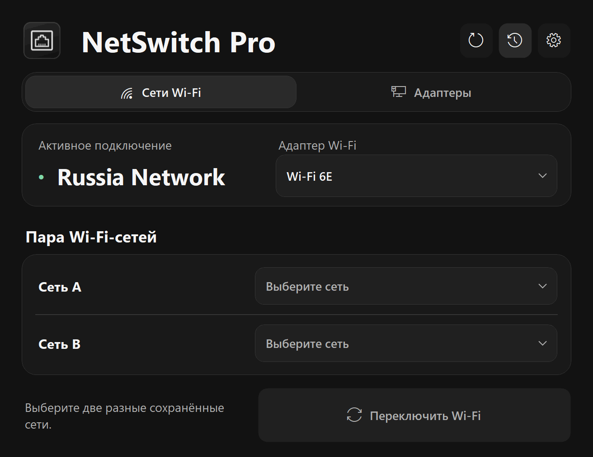
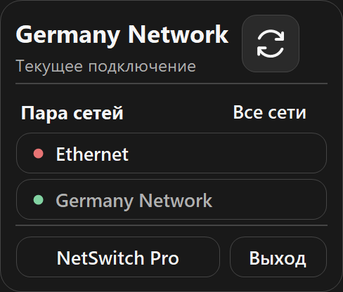

<p align="center">
  
</p>

<h1 align="center">NetSwitch Pro</h1>

<p align="center"><strong>Пара подключений Windows в одном окне.</strong></p>
<p align="center">Выберите две Wi‑Fi-сети, два адаптера или Ethernet и конкретную Wi‑Fi-сеть. Переключайтесь одной кнопкой в окне или одним кликом по значку в трее.</p>

<p align="center">
  <a href="https://github.com/timenti/NetSwitchPro/releases/download/v2.1.1/NetSwitchPro-2.1.1.exe"><strong>Скачать NetSwitch Pro 2.1.1 для Windows</strong></a>
  ·
  <a href="https://github.com/timenti/NetSwitchPro/releases/tag/v2.1.1">Что нового</a>
</p>

<p align="center">
  
</p>

[Смотреть демонстрацию в MP4](https://github.com/timenti/NetSwitchPro/releases/download/v2.1.1/NetSwitchPro-demo.mp4) · [Снимок главного окна](docs/images/wifi.png)

## Зачем я сделал NetSwitch Pro

У меня дома несколько сетей Wi‑Fi. Роутер отправляет трафик каждой сети по своему маршруту, поэтому для смены выхода в интернет достаточно подключиться к другой сети. Например, **Russia Network** может выходить напрямую, а **Germany Network** — через VPN на роутере. Я сделал NetSwitch Pro, чтобы переключаться одной кнопкой и сразу видеть текущее подключение. Маршрут и страну выхода задаёт конфигурация роутера. NetSwitch Pro переключает подключения Windows.

| Сценарий | Сеть №1 | Сеть №2 |
| --- | --- | --- |
| Две Wi‑Fi-сети с разными маршрутами | Wi‑Fi → `Russia Network` | Тот же адаптер → `Germany Network` |
| Кабель и Wi‑Fi | `Ethernet` | Беспроводной адаптер → **Автоматически** |
| Кабель и конкретная точка доступа | `Ethernet` | Беспроводной адаптер → `Germany Network` |
| Рабочая сеть и резерв | Домашний Wi‑Fi | Тот же адаптер → сохранённая мобильная точка доступа |

## Настройте пару сетей

1. Если нужна конкретная Wi‑Fi-сеть, сначала подключитесь к ней через Windows. Профиль сохранится и появится в списке NetSwitch Pro.
2. В полях **Сеть №1** и **Сеть №2** выберите по адаптеру. При выборе беспроводного адаптера открывается его список сохранённых сетей. Выберите профиль или оставьте **Автоматически**, чтобы сеть выбирала Windows. Если нужен один Wi‑Fi-адаптер для обеих позиций, укажите для него два разных профиля.
3. Нажмите **Переключить на …**. Вверху видно текущее подключение, на кнопке — следующая цель. Пара сохраняется между запусками и используется в трее.

Для двух профилей на одном активном Wi‑Fi-адаптере достаточно обычного запуска. Для включения и отключения разных адаптеров нажмите **Запросить права** и подтвердите запрос Windows.

<p align="center">
  
</p>

## Как работает переключение

- **Две Wi‑Fi-сети на одном адаптере.** Программа использует сохранённые профили Windows. Во время переподключения возможен короткий разрыв связи.
- **Два адаптера.** Когда оба подключены, NetSwitch Pro учитывает маршрут Windows при выборе следующего подключения. При переходе программа проверяет готовность нового интерфейса и отключает предыдущий.
- **Ethernet и конкретный Wi‑Fi.** Программа подключает выбранный профиль. Если Wi‑Fi не подключается при активном Ethernet, она может кратковременно отключить кабельный адаптер и повторить попытку. При неудаче она восстанавливает исходное подключение и записывает результат в **Журнал**.

В списке видны статус, тип адаптера и IPv4, если он доступен. **Включён, без подключения** означает, что адаптер включён, но у него сейчас нет связи. Фильтры виртуальных и Bluetooth‑адаптеров находятся справа от текущего подключения. Длинные списки можно прокручивать колёсиком, полосой прокрутки или клавиатурой.

## Управление из трея

- **Левый клик по значку** переключает пару, указанную в главном окне. Во время переключения значок вращается. Галочка означает успех, крестик — ошибку.
- **Правый клик** открывает компактную панель с текущим подключением. Нажмите кнопку со стрелками или выберите конкретную позицию. Зелёная точка отмечает активное подключение. Кнопка **Все сети** открывает сохранённые профили Wi‑Fi.
- **NetSwitch Pro** открывает главное окно. **Выход** завершает работу. Крестик главного окна сворачивает приложение в трей.

<p align="center">
  
</p>

Для запуска в фоне после входа в Windows откройте **Настройки** и включите **Запускать вместе с Windows в трее**. Изменение сохраняется сразу.

## Обновления

<p align="center"></p>

Откройте **Настройки** и нажмите **Проверить обновления**. Если есть новый выпуск, **Обновить** откроет прямую загрузку установщика с GitHub. Запустите скачанный файл. Установщик заменит установленную версию в той же папке. Тема, язык, сохранённая пара подключений и состояние автозапуска сохранятся.

Если GitHub не ответил, **Скачать вручную** откроет страницу последнего релиза.

## Запуск и частые вопросы

**Как запустить?** Скачайте `NetSwitchPro-2.1.1.exe` и откройте его. Установщик для Windows x64 добавит NetSwitch Pro в меню «Пуск». После перехода с переносимой версии открывайте NetSwitch Pro из меню «Пуск».

**Почему сети нет в списке?** Подключитесь к ней через Windows, затем нажмите **Обновить** в NetSwitch Pro. Каждый беспроводной адаптер показывает свои сохранённые профили.

**Почему вверху видно имя адаптера?** Windows может подтвердить подключение к Wi‑Fi, не передав имя профиля. Программа показывает имя адаптера. Если оба профиля привязаны к этому адаптеру, кнопка предлагает **Сеть №1**.

**Как синхронизировать тему с Windows?** Откройте настройки по шестерёнке и выберите **Как в Windows**. В настройках также доступны отдельные светлая и тёмная темы и выбор языка. Изменения сохраняются сразу.

*В демонстрации используется интерфейс NetSwitch Pro с тестовыми подключениями.*

## Сборка из исходников

Для сборки нужен .NET 10 SDK.

```powershell
dotnet publish NetworkAdapterSwitcher.csproj -c Release -r win-x64
```

Готовый EXE появится в `bin/Release/net10.0-windows10.0.19041.0/win-x64/publish/`.

Для сборки установщика укажите путь к компилятору Inno Setup 7.

```powershell
./installer/Build-Installer.ps1 -Compiler 'C:\Program Files\Inno Setup 7\ISCC.exe'
```

[Лицензия](LICENSE)
