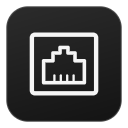
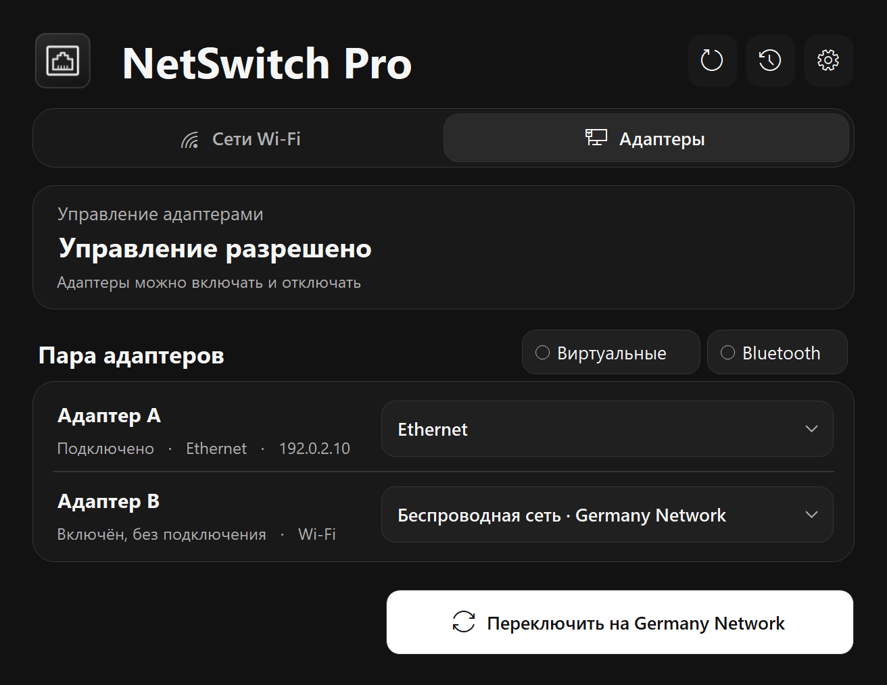

<p align="center">
  
</p>

<h1 align="center">NetSwitch Pro</h1>

<p align="center"><strong>Две Wi‑Fi-сети или два сетевых адаптера одной кнопкой.</strong></p>
<p align="center">Выберите два сохранённых подключения с нужными маршрутами. NetSwitch Pro покажет, какое активно и куда подключит следующее нажатие.</p>

<p align="center">
  <a href="https://github.com/timenti/NetSwitchPro/releases/download/v2.0.3/NetSwitchPro-2.0.3.exe"><strong>Скачать NetSwitch Pro 2.0.3 для Windows</strong></a>
  ·
  <a href="https://github.com/timenti/NetSwitchPro/releases/tag/v2.0.3">Что нового</a>
</p>

<p align="center">
  
</p>

## Зачем я сделал NetSwitch Pro

У меня дома несколько сетей Wi‑Fi. Роутер отправляет трафик каждой сети по своему маршруту, поэтому для смены выхода в интернет достаточно выбрать соседнюю сеть. Я сделал NetSwitch Pro, чтобы делать это одной кнопкой на Windows и видеть, куда направится следующее нажатие.

Например, **Russia Network** может выходить в интернет напрямую, а **Germany Network** — через VPN на роутере с выходом в Германии. Сохраняю обе сети в Windows, задаю их как **Сеть A** и **Сеть B**, и кнопка показывает **«Переключить на Germany Network»**. После подключения она предложит вернуться в **Russia Network**. Маршрут и страну выхода задаёт конфигурация роутера, а NetSwitch Pro подключает выбранную сеть.

| Сценарий | Как использовать |
| --- | --- |
| Разные маршруты через один или несколько роутеров | Сохраните две Wi‑Fi-сети с нужными маршрутами и выберите их на вкладке **Сети Wi‑Fi**. |
| Wi‑Fi и USB‑Ethernet | Выберите физические интерфейсы на вкладке **Адаптеры**, например встроенный Wi‑Fi и Ethernet в док-станции. |
| Основная сеть и резервная точка доступа | Сохраните основной Wi‑Fi и мобильную точку доступа телефона для ручного перехода при сбое. |
| Рабочая и тестовая сеть | Переключайте сохранённые сети, когда проверяете локальный сервис из двух подсетей. |

## Настройте пару Wi‑Fi-сетей

1. **Сохраните обе сети в Windows.** Подключитесь к каждой по очереди через меню Wi‑Fi и дождитесь подключения. Windows сохранит профили.
2. **Выберите пару в NetSwitch Pro.** Откройте **Сети Wi‑Fi**, выберите нужный адаптер и назначьте **Сеть A** и **Сеть B**. Например, `Russia Network` и `Germany Network`. Пара запомнится после закрытия программы.
3. **Нажмите кнопку подключения.** Пока активна сеть A, кнопка предлагает сеть B. После подключения к B она предложит вернуться к A. Если активна другая сеть, первым вариантом будет A.

Для Wi‑Fi достаточно обычного запуска. Паролями и профилями управляет Windows. При смене Wi‑Fi-сети на одном адаптере возможен кратковременный разрыв связи. Результат операции и сообщения Windows доступны в **Журнале**.

[Статичный снимок вкладки Wi-Fi](docs/images/wifi.png)

## Переключайтесь между адаптерами

Используйте вкладку **Адаптеры**, если нужно переходить между двумя интерфейсами, например встроенным Wi‑Fi и USB‑Ethernet. Выберите пару и нажмите **Запросить права**. После подтверждения Windows станет доступно управление адаптерами.

В списке видны имя интерфейса, состояние, тип и IPv4, когда он доступен. Виртуальные и Bluetooth-адаптеры можно показать отдельными фильтрами. Если исходный адаптер подключён, программа ждёт подтверждения связи на новом интерфейсе и затем отключает исходный. Если подключение второго не подтверждается, исходный адаптер остаётся включённым.

<p align="center">
  
</p>

*На снимках и в анимации показан интерфейс NetSwitch Pro с демонстрационными сетями.*

## Быстрый доступ из области уведомлений

После запуска значок **NetSwitch Pro** доступен рядом с часами или под стрелкой **^**. Нажмите его, чтобы увидеть активную сеть и выбранную пару. Нажатие на другую сеть подключает её. Через **Все сохранённые сети** можно выбрать любой профиль выбранного Wi‑Fi‑адаптера.

<p align="center">
  
</p>

Крестик главного окна скрывает его, а значок остаётся в области уведомлений. Чтобы открыть настройки пары, используйте **Открыть NetSwitch Pro**. Для полного завершения программы нажмите **Выход** на быстрой панели.

## Запуск и частые вопросы

**Как установить?** Скачайте файл `NetSwitchPro-2.0.3.exe` и запустите его. Это переносимая сборка для Windows x64 со встроенной средой выполнения.

**Почему сети нет в списке?** Программа показывает профили, сохранённые Windows для выбранного адаптера. Подключитесь к нужной сети через Windows и нажмите **Обновить** в NetSwitch Pro.

**Что означает «Профиль недоступен»?** Windows может сообщить, что Wi‑Fi подключён, при этом ограничить чтение имени текущего профиля. В этом случае первой предлагается сеть A.

**Как синхронизировать тему с Windows?** Откройте настройки по шестерёнке, в поле **Тема** выберите **Как в Windows** и нажмите **Сохранить**. Там же можно оставить светлую или тёмную тему независимо от Windows.

**Как перейти между вкладками?** Нажмите на нужную вкладку либо сдвиньте выделение вправо или влево, удерживая ЛКМ. На сенсорном экране используйте свайп по переключателю.

## Сборка из исходников

Для сборки нужен .NET 10 SDK.

```powershell
dotnet publish NetworkAdapterSwitcher.csproj -c Release -r win-x64
```

Готовый EXE появится в `bin/Release/net10.0-windows/win-x64/publish/`. [Лицензия](LICENSE)
