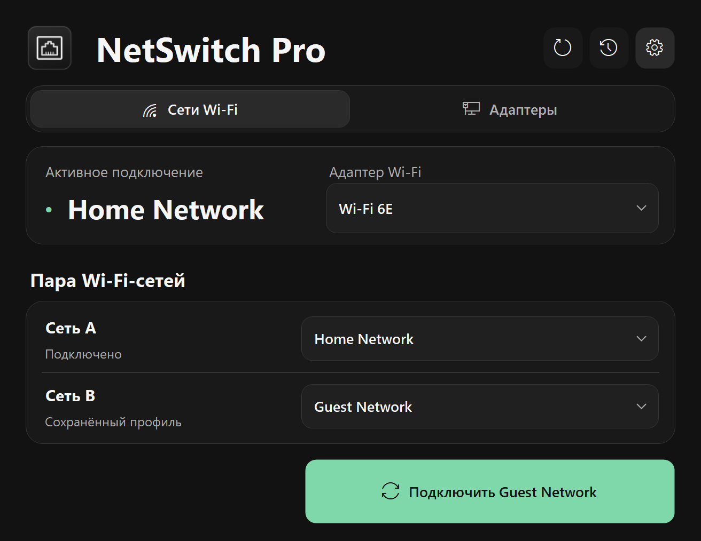

<p align="center">
  
</p>

<h1 align="center">NetSwitch Pro</h1>

<p align="center"><strong>Домашняя и гостевая Wi‑Fi-сеть по одной кнопке.</strong></p>
<p align="center">Выберите два сохранённых подключения. NetSwitch Pro покажет, какое активно сейчас и куда произойдёт переключение.</p>

<p align="center">
  <a href="https://github.com/timenti/NetSwitchPro/releases/download/v2.0.1/NetSwitchPro-2.0.1.exe"><strong>Скачать NetSwitch Pro 2.0.1 для Windows</strong></a>
  ·
  <a href="https://github.com/timenti/NetSwitchPro/releases/tag/v2.0.1">Что нового</a>
</p>

<p align="center">
  
</p>

## Настройте пару Wi‑Fi-сетей

1. **Сохраните обе сети в Windows.** Подключитесь к каждой по очереди через меню Wi‑Fi и дождитесь подключения. Windows сохранит профили.
2. **Выберите пару в NetSwitch Pro.** Откройте **Сети Wi‑Fi**, выберите нужный адаптер и назначьте **Сеть A** и **Сеть B**. Например, `Home Network` и `Guest Network`. Пара запомнится после закрытия программы.
3. **Нажмите кнопку подключения.** Пока активна сеть A, кнопка предлагает сеть B. После подключения к B она предложит вернуться к A. Если активна другая сеть, первым вариантом будет A.

Для Wi‑Fi достаточно обычного запуска. Паролями и профилями управляет Windows. При смене Wi‑Fi-сети на одном адаптере возможен кратковременный разрыв связи. Результат операции и сообщения Windows доступны в **Журнале**.

## Переключайтесь между адаптерами

Используйте вкладку **Адаптеры**, если нужно переходить между двумя интерфейсами, например встроенным Wi‑Fi и USB‑Ethernet. Выберите пару и нажмите **Запросить права**. После подтверждения Windows станет доступно управление адаптерами.

В списке видны имя интерфейса, состояние, тип и IPv4, когда он доступен. Виртуальные и Bluetooth-адаптеры можно показать отдельными фильтрами. Если исходный адаптер подключён, программа ждёт подтверждения связи на новом интерфейсе и затем отключает исходный. Если подключение второго не подтверждается, исходный адаптер остаётся включённым.

<p align="center">
  
</p>

*На скриншотах открыто приложение с демонстрационными сетями.*

## Запуск и частые вопросы

**Как установить?** Скачайте файл `NetSwitchPro-2.0.1.exe` и запустите его. Это переносимая сборка для Windows x64 со встроенной средой выполнения.

**Почему сети нет в списке?** Программа показывает профили, сохранённые Windows для выбранного адаптера. Подключитесь к нужной сети через Windows и нажмите **Обновить** в NetSwitch Pro.

**Что означает «Профиль недоступен»?** Windows может сообщить, что Wi‑Fi подключён, при этом ограничить чтение имени текущего профиля. В этом случае первой предлагается сеть A.

**Где выбрать тему и язык?** Нажмите шестерёнку, выберите тему и язык, затем нажмите **Сохранить**.

## Сборка из исходников

Для сборки нужен .NET 10 SDK.

```powershell
dotnet publish NetworkAdapterSwitcher.csproj -c Release -r win-x64
```

Готовый EXE появится в `bin/Release/net10.0-windows/win-x64/publish/`. [Лицензия](LICENSE)
