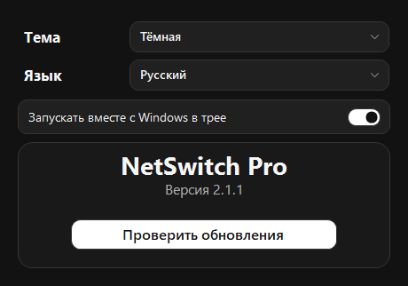

## Обновления из настроек

В компактных **Настройках** видны текущая версия и кнопка **Проверить обновления**. Тема, язык и автозапуск сохраняются сразу. Эта версия без подписи. Для обновления скачайте новый EXE со страницы релиза. Для установки в один клик приложение проверяет SHA‑256 и доверенную подпись издателя.

## Смена версии и Wi‑Fi

- При запуске свежего EXE NetSwitch Pro сам закрывает проверенную старую копию, в том числе 2.0.9, и открывает новую версию без окна с кнопкой повтора.
- Автозапуск и обновления используют постоянный путь к приложению.
- Чтение текущей Wi‑Fi-сети использует Windows API, предусмотренный для работы без разрешения на точное местоположение. Подключение к выбранному сохранённому профилю подтверждается уведомлением Windows о подключении.

**Windows x64.** В релизе есть переносимый EXE, контрольная сумма SHA‑256 и видео настройки пары сетей.

[Руководство](https://github.com/timenti/NetSwitchPro/tree/v2.1.0#readme)
