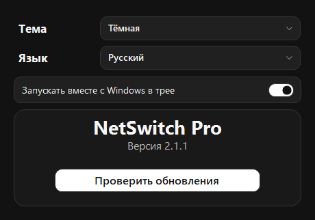

## Что нового в NetSwitch Pro 2.1.1

- **Проверка обновлений в настройках.** Кнопка «Обновить» открывает загрузку установщика с GitHub. Запустите скачанный файл, чтобы обновить программу с сохранением настроек.
- **Компактные настройки.** Тема, язык и автозапуск сохраняются сразу. Видны текущая версия и статус обновления.
- **Переход со старой версии.** Установщик закрывает и заменяет старую установку. Рабочая пара сетей и состояние автозапуска сохраняются.
- **Wi-Fi.** Чтение текущей сети использует интерфейс Windows, предусмотренный для работы без разрешения на точное местоположение.

Для первого запуска скачайте **NetSwitchPro-2.1.1.exe**. В выпуске также есть контрольная сумма и MP4 с демонстрацией интерфейса.

[Руководство](https://github.com/timenti/NetSwitchPro/tree/v2.1.1#readme)
