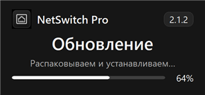

## Что нового в NetSwitch Pro 2.1.2

- **Установщик.** Компактное окно показывает иконку приложения, плашку версии и фактические этапы обновления.
- **Номера версий.** После 2.1.9 выйдет 2.2, после 2.9.9 — 3. Технические теги GitHub сохраняют три части для совместимости с установленными версиями.
- **Загрузка обновлений.** Кнопка в настройках открывает установщик на GitHub. Обновление сохраняет настройки, выбранную пару сетей и состояние автозапуска.

[Руководство и демонстрации](https://github.com/timenti/NetSwitchPro/tree/v2.1.2#readme)
